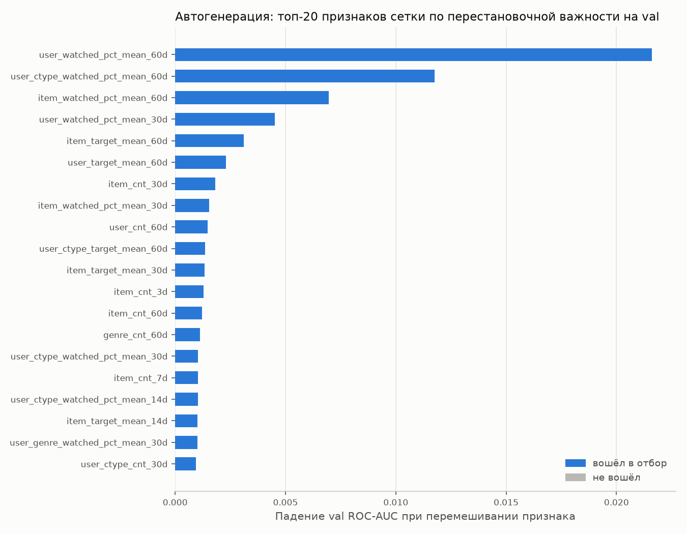

# Автоматическая генерация признаков против ручных: CatBoost на KION dataset

Тестовое задание 1 (Т-Банк, AI Research, Академия): можно ли автоматизировать построение признаков для рекомендательной модели без потери качества.

## Коротко

Сравнивали CatBoost на 20 ручных исторических признаках с автоматической сеткой из 90 признаков (5 сущностей × 6 окон × 3 агрегата) и с сеткой после отбора по val. На test сетка обошла ручной набор на 0.0021 ROC-AUC (0.7509 против 0.7493, 95% bootstrap-интервал [+0.0008; +0.0032]). Отбор оставил 40 признаков без значимой потери качества (−0.0005 к полной сетке, интервал включает 0), но занял 239.5 с против ~54 с на одно обучение. Основной прирост дают сами исторические признаки (+0.091 ROC-AUC к модели без истории); по NDCG@10 ни одна модель не обогнала простую долю досмотров объекта.

## 1. Данные

KION dataset от МТС ([репозиторий](https://github.com/irsafilo/KION_DATASET)): `interactions.csv`, `users.csv`, `items.csv` (версия `data_original`, метаданные на русском).

Что проверено кодом (`src/00_verify.py`, вывод в `results/verify_output.txt`):

| Факт | Значение |
|---|---|
| Строк в `interactions.csv` | 5 476 251 |
| Пользователей | 962 179 |
| Повторов пары (user_id, item_id) | 0 |
| Пустых `watched_pct` | 828 |
| Период | 2021-03-13 … 2021-08-22 |
| Событий на пользователя: среднее / медиана | 5,69 / 2 |
| Пользователей ровно с 1 событием | 36,9% |
| Пользователей без анкеты в `users.csv` | 22,6% |

Замечания, которые важны для воспроизведения:
- В README dataset конец периода указан как 22.08.2022, в данных последняя дата 2021-08-22. Мы опираемся на данные.
- Архив `interactions.csv.zip` в корне репозитория dataset содержит обрезанный файл (52 428 800 байт, около 1,59 млн строк, последняя строка оборвана). Полный `interactions.csv` (180 МБ) лежит в `data_original.zip`. Проверка: `unzip -l interactions.csv.zip` и `unzip -l data_original.zip`.

## 2. Постановка

- **Объект предсказания:** строка `interactions` = пара (пользователь, объект) с датой `last_watch_dt`.
- **Целевая переменная:** `target = 1`, если `watched_pct >= 50`. Порог 50% выбран как соглашение (при нём доля положительных 44,1%, классы близки к балансу), а не подобран.
- **Кандидаты для ранжирования:** объекты, которые пользователь реально смотрел в периоде оценки. Модель упорядочивает их по вероятности досмотра. Это задача переранжирования среди просмотренного, а не поиск по всему каталогу (см. «Ограничения»).
- **Sample:** 50 000 случайных пользователей (seed 42) со всей историей: 283 120 строк после удаления 52 строк с пустым `watched_pct`. Скрипт проверяет, что у каждого выбранного пользователя столько же строк, сколько в исходнике.
- **Разбиение по фиксированным датам** (`results/01_prepare_output.txt`):

| Часть | Даты | Строк | Доля target=1 | Доля строк без прошлого |
|---|---|---|---|---|
| train | 2021-03-13 … 2021-07-25 | 201 721 | 0.469 | 0.262 |
| val | 2021-07-26 … 2021-08-08 | 38 886 | 0.378 | 0.207 |
| test | 2021-08-09 … 2021-08-22 | 42 513 | 0.370 | 0.188 |

«Без прошлого» = у пользователя нет ни одного события в более ранний день, все его признаки истории пусты.

## 3. Почему в признаки не попадает будущее

Правило: для строки с датой T признак считается только по строкам той же группы с датой от T−w до T−1 включительно. События того же дня не используются, потому что дата записана с точностью до дня и порядок внутри дня неизвестен. Сама целевая строка в свои признаки не попадает.

Как это реализовано (`src/features.py`): строки сортируются по ключу «группа, день», правая граница окна находится через `np.searchsorted(..., side="left")` (первая строка текущего дня), левая граница — первая строка с днём ≥ T−w. Сумма на отрезке берётся из префиксных сумм. Пустое окно даёт NaN, а не условное число.

Признаки строк val и test используют исходы более ранних строк из train и val. Это обычный онлайн-режим: к моменту T исходы прошлых событий уже известны. Модель при этом обучается только на строках train.

Допущение о данных: по названию колонки `last_watch_dt` мы считаем, что это дата последнего просмотра пары, то есть к этой дате просмотр пары завершён и её `watched_pct` известен. README dataset этого прямо не описывает, это наша интерпретация.

Независимые проверки (`src/02_check_leakage.py`, вывод в `results/02_leakage_output.txt`), все пройдены:
- **A.** Быстрая функция совпадает с медленным циклом-фильтром (число событий и средний `watched_pct`; сущности user, item, user × жанр; окна 7 и 60 дней; 300 случайных строк): 0 расхождений.
- **B.** Если удалить из данных все строки test, признаки строк train и val не меняются (и для сетки, и для ручного набора). Эта проверка покрывает все признаки.
- **C.** У 68 940 строк без прошлого все счётчики пользователя равны нулю.

## 4. Признаки

Статические (во всех моделях): анкета пользователя (`age`, `income`, `sex`, `kids_flg`) и метаданные объекта (`content_type`, `release_year`, `for_kids`, `age_rating`, основной жанр, происхождение, первая страна). Основной жанр = первый тег из `genres`, который не обозначает происхождение («русские», «зарубежные», «советские») или тип («сериалы»).

Сущности для агрегатов: пользователь, объект, жанр, пользователь × жанр, пользователь × тип контента. Агрегаты: число событий, средний `watched_pct`, доля досмотров. Прямых связей «пользователь × этот объект» нет: каждая пара встречается один раз.

| Набор | Как выбран | Исторических признаков |
|---|---|---|
| Ручной | Окна 7 и 30 дней для пользователя и объекта, 60 дней для пар, плюс два отношения: «досмотр жанра минус обычный досмотр пользователя» и «доля жанра в просмотрах пользователя» | 20 |
| Сетка | Все 5 сущностей × окна {1, 3, 7, 14, 30, 60} × 3 агрегата, без участия человека | 90 |

Окно «вся история» в сетку не входит: объём событий за период вырос в 4–5 раз, и счётчики «за всё время» в test выходили бы за диапазон train.

Честное примечание: ручной набор зафиксирован до запусков на рабочем sample (50 000 пользователей), но после черновых прогонов на 5 000 пользователях, поэтому он не полностью «слепой».

## 5. Автоматический отбор по валидации

1. CatBoost на всей сетке (обучение на train, early stopping по val).
2. Перестановочная важность на val: для каждого признака сетки перемешиваем его значения в val (2 повтора) и смотрим, насколько падает val ROC-AUC.
3. Признаки сортируются по этому падению, число K выбирается из {10, 20, 40, все 90} по val ROC-AUC.
4. Финальная модель на статических признаках + K лучших.

Время отбора считается полностью: обучение модели на всей сетке + перестановки + перебор K.

Шаги 3–4 на практике запускались отдельными процессами (`src/04b_k_run.py`, `src/04c_final_selected.py`). В окружении (Python 3.14.8) процессы периодически завершались аварийно (segfault) в разных библиотеках: `_catboost.so`, pandas, numpy; причина не установлена. Поэтому каждое обучение шло отдельным процессом, а ключевые результаты перепроверены повторным запуском: K=10 и K=90 дали те же val ROC-AUC (0.7288 и 0.7329 против 0.7330 в первом прогоне).

## 6. Протокол сравнения

- Одинаковые: разбиение, строки-кандидаты, статические признаки, параметры CatBoost (`iterations=1000`, `learning_rate=0.08`, `depth=6`, `eval_metric="AUC"`, early stopping 50 по val). Гиперпараметры не подбирались ни для одного подхода.
- Все решения (число деревьев, K, набор признаков) принимаются только по val. Метрики test считаются в одном месте, `src/05_report.py`.
- Каждая модель обучается с 3 seed (0, 1, 2), в таблице среднее ± стандартное отклонение.
- Разница AUC между подходами оценивается парным bootstrap по пользователям на test, 300 повторов (пользователь входит в выборку целиком, потому что его строки зависимы).
- NDCG@10 считается только по пользователям, у которых в test ≥ 2 строк и есть оба класса: для остальных NDCG не зависит от модели. Для сравнения приведён NDCG случайного порядка на тех же пользователях.
- Опорные точки без обучения: константа, случайный порядок, доля досмотров объекта за 30 дней, доля досмотров пользователя за 30 дней.

## 7. Результаты

Test: 42 513 строк, 13 821 пользователь. NDCG@10 считается по 4 413 пользователям, у которых в test есть и досмотры, и недосмотры. Для моделей: среднее ± стандартное отклонение по 3 seed (`results/results_table.md`).

| Подход | Ист. признаков | Test ROC-AUC | Test LogLoss | Test NDCG@10 | Val ROC-AUC | Время признаков, с | Время отбора, с | Обучение, с |
|---|---|---|---|---|---|---|---|---|
| Константа (доля 1 в train) | 0 | — | 0.6791 | — | 0.5000 | — | — | — |
| Случайный порядок | 0 | 0.4970 | — | 0.7339 | 0.4993 | — | — | — |
| Доля досмотров объекта за 30 дн. | 0 | 0.6683 | 0.8111 | 0.8138 | 0.6572 | — | — | — |
| Доля досмотров пользователя за 30 дн. | 0 | 0.6267 | 1.5743 | 0.6462 | 0.6071 | — | — | — |
| CatBoost: без истории | 0 | 0.6584 ± 0.0018 | 0.6365 ± 0.0007 | 0.8035 ± 0.0013 | 0.6570 ± 0.0008 | — | — | 75.1 ± 20.7 |
| CatBoost: ручные признаки | 20 | 0.7493 ± 0.0007 | 0.5671 ± 0.0006 | 0.7979 ± 0.0018 | 0.7328 ± 0.0003 | 0.90 ± 0.00 | — | 57.4 ± 4.4 |
| CatBoost: вся сетка | 90 | 0.7509 ± 0.0007 | 0.5638 ± 0.0009 | 0.7985 ± 0.0007 | 0.7333 ± 0.0004 | 1.55 ± 0.00 | — | 54.2 ± 3.6 |
| CatBoost: сетка + отбор по val | 40 | 0.7505 ± 0.0008 | 0.5626 ± 0.0004 | 0.7997 ± 0.0009 | 0.7335 ± 0.0002 | 1.33 ± 0.21 | 239.5 ± 0.0 | 46.6 ± 3.9 |

Разница AUC на test, парный bootstrap по пользователям (300 повторов, прогнозы усреднены по seed):

| Сравнение | ΔAUC | 95% интервал | Интервал включает 0 |
|---|---|---|---|
| ручные признаки − без истории | +0.0909 | [+0.0857; +0.0966] | нет |
| вся сетка − ручные признаки | +0.0021 | [+0.0008; +0.0032] | нет |
| сетка + отбор − ручные признаки | +0.0015 | [+0.0000; +0.0027] | нет (нижняя граница ≈ 0) |
| сетка + отбор − вся сетка | −0.0005 | [−0.0013; +0.0002] | да |

Выбор K на val (seed 0, `results/auto_k_sweep.csv`):

| K | Val ROC-AUC | Обучение, с |
|---|---|---|
| 10 | 0.7288 | 47.9 |
| 20 | 0.7301 | 54.4 |
| 40 | **0.7333** | 66.5 |
| 90 (вся сетка) | 0.7329 | 51.8 |

Разница между K=40 и K=90 (0.0004) меньше разброса между seed (~0.001).

Какие окна выбрал отбор (`results/auto_selected_breakdown.csv`):

| Сущность | 1д | 3д | 7д | 14д | 30д | 60д |
|---|---|---|---|---|---|---|
| genre | 1 | 0 | 1 | 0 | 1 | 2 |
| item | 2 | 2 | 2 | 2 | 3 | 3 |
| user | 1 | 0 | 1 | 1 | 2 | 3 |
| user_ctype | 1 | 1 | 2 | 2 | 2 | 3 |
| user_genre | 0 | 0 | 0 | 0 | 1 | 1 |
| **Всего** | 5 | 3 | 6 | 5 | 9 | 12 |

По агрегатам: средний `watched_pct` 16, доля досмотров 12, число событий 12.



## 8. Анализ

1. **Исторические признаки поверх статических.** Ручной набор лучше модели без истории на +0.0909 ROC-AUC [+0.0857; +0.0966], LogLoss 0.6365 → 0.5671. Это главный эффект во всём эксперименте; выбор окон на его фоне вторичен.
2. **Сетка против ручного набора.** +0.0021 ROC-AUC [+0.0008; +0.0032], LogLoss 0.5671 → 0.5638. Выигрыш небольшой, но интервал не включает ноль. Оговорка: сетка содержит в 4.5 раза больше признаков, а ручной набор составлен после черновых прогонов, то есть сравнение не идеально симметрично.
3. **Что дал отбор.** 40 признаков вместо 90 без значимой потери (−0.0005 [−0.0013; +0.0002]) и с лучшим LogLoss (0.5626). Относительно ручного набора +0.0015 [+0.0000; +0.0027], на границе значимости. Обучение финальной модели быстрее (46.6 с против 54.2 с), но сам отбор стоит 239.5 с, то есть дороже нескольких обучений. Выигрыш отбора проявляется только при применении модели (меньше признаков считать и хранить), а не при её построении.
4. **Окна.** Отбор тянется к длинным окнам: 30 и 60 дней дают 21 из 40 признаков, 3 дня — 3. Окно 7 дней ничем не выделяется. Объяснение видно по данным (`results/02_leakage_output.txt`): короткие окна в большинстве строк пустые. Окно пользователя за 1 день пусто в 71.9% строк, за 7 дней в 42.7%, за 60 дней в 25.5%; для пары «пользователь × жанр» за 1 день пусто в 89.2%. Пустой признак не несёт сигнала, поэтому при медиане 2 события на пользователя отбор предпочитает длинные окна. Поскольку 60 дней — максимум сетки и оно лидирует, оптимум может лежать за её пределами. Перестановочная важность делится между коррелированными признаками соседних окон, поэтому таблица показывает тенденцию, а не точный выбор.
5. **NDCG@10.** Все модели заметно лучше случайного порядка (0.7339), но простая доля досмотров объекта за 30 дней даёт 0.8138, выше всех CatBoost (0.798–0.800), а модель без истории (0.8035) выше ручного набора (0.7979). Гипотеза, не проверенная: NDCG считается внутри пользователя, где признаки пользователя постоянны и не помогают упорядочить его объекты; модель же обучается на глобальный LogLoss, и прирост AUC в основном идёт от различий между пользователями. Проверка: AUC внутри пользователя и модель с ranking loss (например, YetiRank в CatBoost).
6. **Test против val.** На test ROC-AUC у всех моделей выше, чем на val (например, 0.7493 против 0.7328 у ручного набора). Причину мы не исследовали.

## 9. Вычислительные затраты и масштабируемость

Замер масштабирования не выполнен: запуск `src/06_scaling.py` (10–200 тыс. пользователей) дважды завершился аварийно (segfault в pandas и numpy) в том же окружении, см. раздел 5. На рабочем sample (50 000 пользователей, 283 120 строк) расчёт признаков занимает 2.15 с для сетки из 90 признаков и 1.44 с для ручного набора из 20 (`results/02_leakage_output.txt`). Обучение одной модели CatBoost занимает 47–57 с, отбор по val 239.5 с.

Сложность расчёта одной сущности: сортировка O(N log N) плюс линейный проход. Обучение CatBoost и перестановочная важность растут с числом признаков, поэтому основная цена автоматического подхода — в отборе, а не в генерации.

## 10. Ограничения

- **Кандидаты = просмотренные объекты.** Модель ранжирует только то, что пользователь уже начал смотреть; качество поиска по всему каталогу здесь не оценивается.
- **Короткие истории.** Медиана 2 события на пользователя, у 19–26% строк история пуста (см. таблицу разбиения). Исторические признаки пользователя для них не работают.
- **Сдвиг во времени.** Доля досмотров по неделям меняется (`results/verify_output.txt`, блок 6): у сериалов в июне она росла с примерно 0,21 до 0,54 и снова падала, у фильмов в неделю 19–25 июля упала с 0,544 до 0,434. Причину мы не знаем. Train смешивает разные режимы, val и test похожи между собой (доля target=1: 0.469 в train против 0.378 и 0.370). Абсолютный LogLoss страдает от сдвига, поэтому подходы сравниваются между собой на одном разбиении.
- **Статистика объектов по sample.** Популярность объекта считается только по событиям выбранных пользователей (50 000 из 962 179, около 5,2% аудитории).
- **Дата с точностью до дня.** События одного дня не видят друг друга, часть информации теряется.
- **Пространство поиска сетки ограничено.** Сетка не строит отношения между сущностями (как два отношения в ручном наборе) и не перебирает новые связи; автоматизирован выбор окон, сущностей и агрегатов из заданного списка. Самое длинное окно — 60 дней.
- **Перестановочная важность и коррелированные признаки.** Если признаки близких окон похожи, перемешивание одного почти не вредит модели, и такие признаки получают заниженную важность.
- **Статистика сравнения.** 3 seed и 300 повторов bootstrap дают грубоватые границы интервалов; сравнение «сетка + отбор − ручные» с нижней границей ≈ 0 следует считать пограничным.
- **Один dataset, одна постановка** (досмотр ≥ 50%). Графовые модели и модели над историей событий не пробовали.
- Данные анонимизированы, авторы dataset указывают, что в них добавлен случайный шум.

## 11. Воспроизведение

Окружение: Python 3.14.8, CatBoost 1.2.10, зависимости в `requirements.txt` (версии зафиксированы с машины, где делался прогон).

```bash
git clone https://github.com/irsafilo/KION_DATASET.git
mkdir -p data/raw results
python -m zipfile -e KION_DATASET/data_original.zip /tmp/kion   # полный interactions.csv лежит здесь
cp /tmp/kion/data_original/{interactions,users,items}.csv data/raw/
python src/00_verify.py | tee results/verify_output.txt   # проверка данных
bash run_all.sh                                           # шаги 01-05, выводы в results/
```

| Скрипт | Что делает |
|---|---|
| `src/config.py` | все настройки: размер sample, даты, окна, параметры CatBoost |
| `src/00_verify.py` | проверка фактов о данных |
| `src/01_prepare_sample.py` | sample пользователей, чистка, разбиение по датам |
| `src/features.py` | расчёт признаков по окнам, ручной набор и сетка |
| `src/02_check_leakage.py` | три проверки на утечку, время расчёта признаков |
| `src/03_train_manual.py` | опорные точки, CatBoost без истории, CatBoost на ручных признаках |
| `src/04_auto_features.py` | сетка, CatBoost на всей сетке, перестановочная важность (шаги 1–3 отбора) |
| `src/04b_k_run.py` | одно значение K на запуск, результат в `results/auto_k_sweep_runs.csv` |
| `src/04c_final_selected.py` | выбор K по val и финальная модель, один seed на запуск |
| `src/04d_breakdown.py` | разбивка отобранных признаков по сущностям, окнам и агрегатам |
| `src/05_report.py` | метрики test, bootstrap, таблица и график |
| `src/06_scaling.py` | время расчёта признаков от 10 тыс. пользователей до всего dataset (полный замер не выполнен) |

## Источник данных

Petrov A., Safilo I., Tikhonovich D., Ignatov D. *MTS Kion Implicit Contextualised Sequential Dataset for Movie Recommendation.* ACM RecSys CARS Workshop, 2022. BibTeX — в README репозитория dataset.
